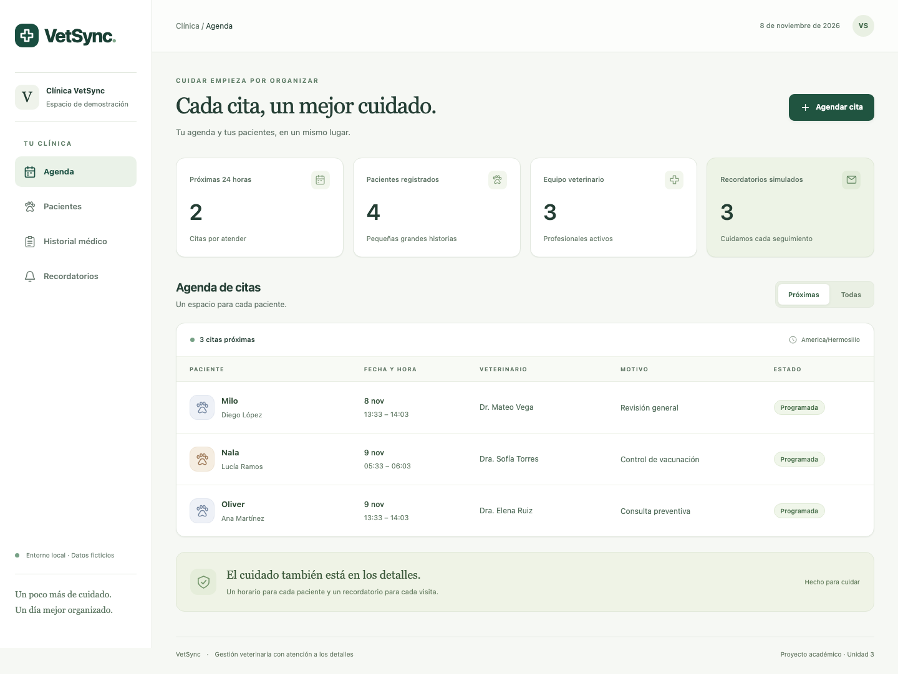
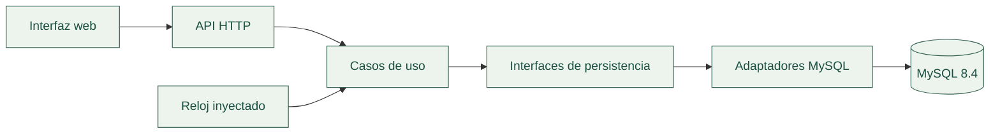

<div align="center">


# VetSync

### Cada cita, un mejor cuidado.

<p>Gestión de citas veterinarias, pacientes e historial médico en un mismo lugar.<br />
Una aplicación local con agenda sin choques y recordatorios por correo simulados.</p>

<p>
  
  
  
  
  
</p>

[](https://github.com/donatohdez/VetSync/actions/workflows/ci.yml)

**Monolito modular · TDD · SOLID · Desarrollo asistido por IA**

[Funciones](#funciones) · [Puesta en marcha](#puesta-en-marcha) · [Verificación](#verificación) · [Entregables](#desarrollo-con-ia-y-entregables) · [Equipo](#equipo)

</div>

---

## El proyecto

VetSync organiza el trabajo de una clínica veterinaria: vincula mascotas con sus dueños, registra su historial médico y permite agendar citas sin superponer horarios de un mismo veterinario. Los recordatorios próximos se conservan como correos simulados en MySQL, sin realizar envíos reales.

El proyecto corresponde a la **primera asignación de la unidad 3** de **Optativa I: Fundamentos de la Inteligencia Artificial en la Ingeniería de de Software**. Además del sistema funcional, documenta el uso de IA, los ciclos de pruebas y la revisión crítica del código generado.

**Estado actual:** código publicado, revisión independiente de Claude atendida y CI comprobado en GitHub. La aplicación se ejecuta localmente; el repositorio incluye las instrucciones y los documentos para su revisión académica.

## Índice

1. [Funciones](#funciones)
2. [Tecnologías](#tecnologías)
3. [Arquitectura y datos](#arquitectura-y-datos)
4. [Puesta en marcha](#puesta-en-marcha)
5. [Configuración](#configuración)
6. [API](#api)
7. [Verificación](#verificación)
8. [Estructura del proyecto](#estructura-del-proyecto)
9. [Desarrollo con IA y entregables](#desarrollo-con-ia-y-entregables)
10. [Equipo](#equipo)
11. [Alcance y limitaciones](#alcance-y-limitaciones)

## Funciones

| Sección | Qué permite hacer |
| :--- | :--- |
| **Agenda** | Recepción selecciona mascota, veterinario, fecha, hora y motivo. Puede registrar un dueño y su mascota durante la reserva; filtrar próximas o todas. |
| **Pacientes** | Registrar dueños y mascotas, consultar sus datos y acceder al historial de cada paciente. |
| **Historial médico** | Agregar notas clínicas con fecha y veterinario; consultar primero las atenciones más recientes. |
| **Recordatorios** | Ejecutar avisos para citas de las próximas 24 horas y consultar los correos simulados guardados. |
| **Resumen de la clínica** | Consultar citas próximas, pacientes registrados, veterinarios activos y recordatorios simulados. |

La interfaz se adapta a escritorio y móvil, incluye selectores con búsqueda y contexto del paciente, historial en línea de tiempo y estados de carga y error. Las citas duran 30 minutos: hay 16 turnos de 10:00 a 17:30, con cierre a las 18:00 en la zona de la clínica. El fin se calcula automáticamente. Los turnos pasados u ocupados se deshabilitan y el servidor vuelve a validar cada reserva, incluso frente a solicitudes concurrentes.

El dashboard está pensado para personal de la veterinaria. La reserva directa por el dueño desde un portal público queda fuera de esta versión.

<p align="center">
  
</p>

<p align="center"><sub>Vista real de la aplicación local con datos ficticios de demostración.</sub></p>

## Tecnologías

| Capa | Herramientas | Uso en VetSync |
| :--- | :--- | :--- |
| **Lenguaje y ejecución** | TypeScript 6.0 · Node.js 24+ | Tipado estricto y ejecución del backend. |
| **API** | Express 5.3 · Zod · Helmet | Rutas HTTP, validación de entradas y cabeceras de seguridad. |
| **Datos** | MySQL 8.4 · mysql2 | Persistencia relacional, consultas parametrizadas y transacciones InnoDB. |
| **Interfaz** | HTML · CSS · TypeScript | Pantallas adaptables, formularios y consumo de la API desde el navegador. |
| **Pruebas** | Vitest 5.1 · Supertest · Playwright 1.65 | Casos unitarios, integración HTTP/MySQL y recorridos de navegador. |
| **Herramientas** | ESLint · Prettier · esbuild · tsx | Revisión estática, formato, compilación del frontend y desarrollo. |
| **Infraestructura** | Docker Compose · GitHub Actions | Base local reproducible y verificaciones automáticas en cada push y PR. |

Las versiones exactas están fijadas en [package.json](package.json) y [package-lock.json](package-lock.json).

## Arquitectura y datos

Se utiliza un **monolito modular**: un servidor y una base de datos, con seis módulos separados por responsabilidad. Los casos de uso dependen de interfaces de persistencia y de un reloj inyectable; los adaptadores resuelven el acceso a MySQL.



| Módulo | Responsabilidad |
| :--- | :--- |
| `owners` | Dueños y datos de contacto. |
| `pets` | Mascotas y su asociación con un dueño. |
| `veterinarians` | Consulta de veterinarios activos. |
| `medical-records` | Entradas del historial de cada mascota. |
| `appointments` | Validación y reserva de citas. |
| `notifications` | Selección de citas próximas y registro único de avisos. |

**Citas sin choques.** La reserva bloquea la fila del veterinario dentro de una transacción `READ COMMITTED`, comprueba los cruces e inserta la cita. Así se protege también la primera reserva cuando llegan solicitudes simultáneas. Las citas contiguas sí se permiten.

**Avisos sin duplicados.** Una restricción única por cita y tipo de aviso impide registrar dos recordatorios, incluso si la simulación se ejecuta simultáneamente. La ventana es `ahora < inicio <= ahora + REMINDER_HOURS`.

**Fechas coherentes.** Los instantes se almacenan en UTC; la agenda y el texto de los avisos se muestran en la zona de la clínica. Los formularios indican que la captura de hora usa la zona del dispositivo.

El [modelo y las decisiones de arquitectura](docs/arquitectura/ARQUITECTURA.md) explican los límites de módulos, relaciones e índices. El esquema ejecutable está en [la migración inicial](database/migrations/001-initial.sql).

## Puesta en marcha

### Requisitos

- **Node.js 24 o superior** y npm.
- **Git** para clonar el repositorio.
- **Docker Desktop** o Docker con Compose, en ejecución.

### 1. Preparar el proyecto

```sh
git clone https://github.com/donatohdez/VetSync.git
cd VetSync
npm ci
cp .env.example .env
```

Si ya tienes una copia configurada, conserva tu `.env`. Los comandos siguientes se ejecutan desde la raíz del proyecto.

### 2. Iniciar MySQL y cargar datos

```sh
docker compose up -d --wait
npm run db:migrate
npm run db:seed
```

El seed inserta **tres dueños, cuatro mascotas, tres veterinarios y cuatro citas**, con datos ficticios. No borra registros existentes ni cambia las fechas de citas ya creadas. Los horarios iniciales se calculan respecto al momento de la primera carga; si ya pasaron, pueden consultarse con el filtro **Todas**.

### 3. Compilar e iniciar

```sh
npm run build
npm start
```

Abre **[http://127.0.0.1:3010](http://127.0.0.1:3010)**. MySQL se publica en `127.0.0.1:33316`; el servidor escucha en `127.0.0.1:3010`.

`Ctrl+C` detiene la aplicación. `docker compose stop` detiene MySQL y conserva sus datos.

<details>
<summary><strong>Desarrollo, nombre de Compose y problemas frecuentes</strong></summary>

Para trabajar en el backend, usa `npm run dev`. Si cambias la interfaz TypeScript, ejecuta `npm run build` para regenerarla: el modo dev actual no recompila automáticamente el frontend.

El nombre de Compose está fijado en `te-x20` para conservar el contenedor y volumen creados antes del traslado del proyecto a la carpeta VetSync. Su funcionamiento no depende del nombre del directorio.

| Situación | Qué comprobar |
| :--- | :--- |
| Docker no responde | Inicia Docker Desktop antes de levantar MySQL. |
| La aplicación no conecta a MySQL | Ejecuta `docker compose ps` y revisa las variables `DB_*` de `.env`. |
| El puerto ya está ocupado | Para la aplicación puedes cambiar `PORT`; el puerto de BD debe coincidir en Compose y `DB_PORT`. |
| No aparecen citas próximas | Revisa el filtro **Todas** o agenda una cita futura; repetir el seed no actualiza fechas anteriores. |
| No se genera un recordatorio | La cita debe entrar en la ventana configurada y no tener un aviso previo. |
| El cambio de frontend no se refleja | Repite `npm run build` y recarga la página. |

</details>

## Configuración

La plantilla [`.env.example`](.env.example) contiene los valores de demostración local. `.env` está excluido de Git.

| Variable | Valor inicial | Propósito |
| :--- | :--- | :--- |
| `DB_HOST` | `127.0.0.1` | Dirección de MySQL. |
| `DB_PORT` | `33316` | Puerto publicado por Compose. |
| `DB_USER` | `vetsync` | Usuario de la aplicación. |
| `DB_PASSWORD` | Definida en `.env.example` | Contraseña ficticia para el contenedor local. |
| `DB_NAME` | `vetsync` | Base de demostración. |
| `HOST` | `127.0.0.1` | Interfaz donde escucha el servidor. |
| `PORT` | `3010` | Puerto de la aplicación. |
| `CLINIC_TIMEZONE` | `America/Hermosillo` | Zona de la agenda y del texto de recordatorios; se valida al arrancar. |
| `REMINDER_HOURS` | `24` | Ventana de anticipación para los avisos. |

Cambiar el usuario, contraseña o nombre de BD requiere mantener coherencia con Compose. Las variables de inicialización de MySQL se aplican cuando se crea el volumen por primera vez.

## API

Base local: `http://127.0.0.1:3010/api`. Las escrituras requieren `Content-Type: application/json`.

| Recurso | Operaciones |
| :--- | :--- |
| `/health` y `/config` | Salud de la base y configuración de presentación. |
| `/owners` | Consultar y registrar dueños. |
| `/pets` | Consultar y registrar mascotas. |
| `/veterinarians` | Consultar veterinarios activos. |
| `/pets/{petId}/medical-records` | Consultar y agregar notas clínicas de una mascota. |
| `/appointments` | Consultar y reservar citas; un choque devuelve `409`. |
| `/notifications` | Consultar correos simulados. |
| `/notifications/run` | Ejecutar la simulación mediante `POST` con cuerpo `{}`. |

El [documento de API](docs/api/API.md) incluye métodos, reglas de fechas, ejemplos y errores. El [contrato OpenAPI](docs/api/openapi.json) permite consultar los esquemas y respuestas.

## Verificación

### Pruebas locales

```sh
npm run db:prepare-test
npm test
npm run test:integration
npm run check
```

`db:prepare-test` crea y migra **vetsync_test**, una base separada. Las pruebas de integración limpian únicamente esa base antes de cada caso; la base de demostración `vetsync` se conserva. `npm run check` ejecuta tipos, linter, compilación y cobertura de unitarias más integración.

Para verificar la interfaz:

```sh
npx playwright install chromium
DB_NAME=vetsync_test npm run db:seed
npm run test:e2e
```

Playwright inicia su propio servidor en el puerto `3011`. No ejecutes integración y navegador simultáneamente: comparten `vetsync_test`. La variable opcional `PLAYWRIGHT_CHROMIUM_EXECUTABLE_PATH` permite utilizar un Chromium ya instalado.

### Resultados comprobados

| Comprobación | Resultado registrado |
| :--- | :--- |
| Unitarias | **49 aprobadas**. |
| Integración HTTP/MySQL | **32 aprobadas**, incluidas reservas y avisos concurrentes. |
| Navegador | **10 recorridos aprobados**: recepción, alta durante reserva, disponibilidad, selectores, historial, errores y móvil. |
| Cobertura de líneas | **98.70%**. |
| Cobertura de ramas | **97.82%**. |
| Cobertura de funciones y sentencias | **98.63% funciones; 98.33% sentencias**. |
| Umbral configurado | **80% mínimo** en las cuatro métricas. |
| CI remoto | Instalación limpia, migración, tipos, linter, compilación, pruebas y artefactos aprobados. |

Las pruebas cubren solapamientos, citas contiguas, referencias inválidas, límites de recordatorios, zonas horarias, errores de transacción, consultas parametrizadas y representación segura de notas. Cuatro mutaciones temporales de operadores SQL fueron detectadas por pruebas de integración; después se restauró el código correcto.

El [informe de pruebas](outputs/INFORME-PRUEBAS.md) explica la cobertura y sus exclusiones. [CI remoto](outputs/CI-REMOTO.md) conserva el enlace y la evidencia de una ejecución aprobada. El estado del último commit está en [GitHub Actions](https://github.com/donatohdez/VetSync/actions/workflows/ci.yml); el workflow corre en cada push y PR.

## Estructura del proyecto

```text
VetSync/
├── .github/workflows/       # Verificación automática en GitHub
├── database/migrations/    # Esquema e índices versionados
├── docs/
│   ├── api/                # Documentación y contrato OpenAPI
│   ├── arquitectura/       # Modelo y decisiones técnicas
│   ├── assets/             # Identidad y captura del README
│   ├── calidad/            # Registro de ciclos TDD
│   ├── evidencias/         # Resultados, capturas y revisiones
│   ├── ia/                 # Prompts, respuestas y crítica
│   ├── referencias/        # Material original de la asignación
│   └── requisitos/         # Matriz de requisitos y supuestos
├── outputs/                # Documentos para revisión y entrega
├── scripts/                # Migraciones, datos ficticios y tareas auxiliares
├── src/
│   ├── modules/            # Seis módulos de negocio
│   ├── shared/             # Reloj, validación, configuración y transacciones
│   ├── http/               # Rutas y manejo central de errores
│   ├── web/                # Interfaz HTML, CSS y TypeScript
│   ├── composition.ts      # Ensamblado de dependencias
│   └── server.ts           # Inicio y cierre del servidor
├── tests/                  # Unitarias, integración y navegador
├── AGENTS.md               # Convenciones de trabajo con IA
├── compose.yaml            # MySQL local
└── .env.example            # Configuración de demostración
```

`node_modules/`, `dist/`, `coverage/` y `work/` son archivos de desarrollo o ejecución excluidos de Git.

## Desarrollo con IA y entregables

La IA se utilizó durante el desarrollo y la revisión. **La aplicación no incorpora un modelo de IA en sus funciones de negocio.** Codex apoyó la planificación, implementación y validación; Claude Code realizó una revisión independiente cuyos hallazgos se contrastaron antes de corregirlos.

| Documento | Contenido |
| :--- | :--- |
| [Bitácora de cinco interacciones](outputs/BITACORA-PROMPTS.md) | Prompts conservados, herramientas, respuestas y crítica de las decisiones. |
| [Reflexión técnica](outputs/REFLEXION-TECNICA.md) | 370 palabras sobre ahorro de tiempo, carga cognitiva y prevención de deuda técnica. |
| [Informe de pruebas](outputs/INFORME-PRUEBAS.md) | Casos verificados, resultados, cobertura y límites de la evidencia. |
| [Revisión de Claude](outputs/RESULTADO-REVISION-CLAUDE.md) | Hallazgos aceptados, cambios comprobados y mejoras pospuestas. |
| [Guía de entrega](outputs/ENTREGA.md) | Enlace al código, documentos y revisión final antes de enviar. |
| [Requisitos](docs/requisitos/MATRIZ.md) | Diferencia entre obligaciones explícitas, sugerencias y decisiones del proyecto. |
| [Registro TDD](docs/calidad/REGISTRO-TDD.md) | Secuencia de pruebas fallidas, implementación y validación posterior. |

Los registros distinguen las modificaciones de los asistentes de las decisiones y aportes reales del estudiante. La bitácora y la reflexión se conservan para revisión final del equipo; el [plan original](outputs/PLAN-DE-TRABAJO.md) documenta la etapa previa al desarrollo.

## Equipo

| N.º | Integrante |
| :---: | :--- |
| 1 | Manuel Donato Hernández Burgos |
| 2 | Jesús Alejandro Karam Leal |
| 3 | Cristopher Alejandro Reyes Yocupicio |
| 4 | Humberto Barreras Carrisoza |
| 5 | Juan Carlos Apodaca Wong |

## Alcance y limitaciones

VetSync es una **demostración académica local con datos ficticios**. Los veterinarios se cargan con el seed y los avisos se ejecutan manualmente desde la interfaz o la API.

Esta versión no incluye autenticación, videollamadas, cancelación, reprogramación, paginación ni despliegue público. Aunque el título académico menciona telemedicina, los requisitos entregados no definen videollamadas o chat. El usuario definió citas de 30 minutos y horario de 10:00 a 18:00. No se ha establecido un horizonte máximo para reservar.

Se utilizan consultas parametrizadas, claves foráneas, validación de entradas, límite del cuerpo JSON, cabeceras de seguridad y salidas de error controladas. Las notas se muestran como texto. El detalle de estas decisiones y sus límites está en la [documentación de arquitectura](docs/arquitectura/ARQUITECTURA.md).

---

<p align="center"><strong>VetSync</strong> · Organizar mejor para cuidar mejor.<br /><sub>Proyecto académico · Unidad 3 · Desarrollo asistido por inteligencia artificial</sub></p>
