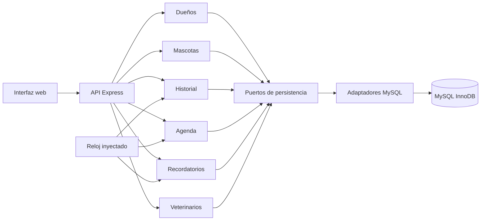
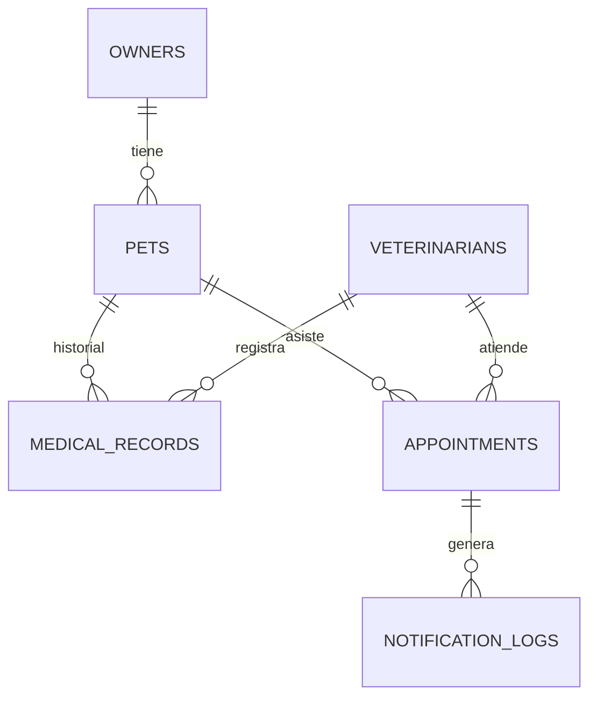

# Arquitectura de VetSync

## Contexto y módulos

Un monolito modular con un servidor HTTP y una BD MySQL 8.4. El transporte HTTP valida el formato y delega en casos de uso. Las reglas no dependen de Express ni de mysql2. La composición de adaptadores está en `src/composition.ts`.

No se crea una clase de servicio para listar veterinarios: no hay una regla adicional que justifique otra capa. Las clases de casos de uso dependen de interfaces pequeñas. El correo es un registro simulado persistente; no hay envío SMTP.

## Modelo relacional

El esquema ejecutable y sus índices están en `database/migrations/001-initial.sql`. Las fechas de citas, historial y avisos se almacenan como DATETIME(3) interpretado en UTC por el adaptador. La fecha de nacimiento es DATE, sin hora. Las consultas usan parámetros.

## Reserva transaccional

1. Validar referencias, fechas con zona, futuro e intervalo.
2. Comenzar transacción READ COMMITTED.
3. Bloquear la fila del veterinario activo con `SELECT ... FOR UPDATE`.
4. Verificar mascota y consultar cruces con `starts_at < nuevoFin AND ends_at > nuevoInicio`.
5. Insertar o devolver conflicto; confirmar o deshacer y liberar la conexión. Si también falla el rollback, conservar ambos fallos en un AggregateError cuya causa es el error original.

La fila del veterinario existe aun cuando no tiene citas; esto protege la primera reserva simultánea. Se permiten citas contiguas y horarios iguales de veterinarios distintos. Las reglas futuras de reprogramación tendrían que seguir el mismo protocolo.

Las lecturas de referencias y las proyecciones SQL con JOIN son fronteras de integración explícitas: los adaptadores pueden consultar identificadores y proyecciones de tablas relacionadas. Los casos de uso no importan adaptadores ajenos ni acceden a sus repositorios internos. La agenda coordina el bloqueo de veterinario y la escritura de cita dentro de una sola transacción; no se distribuye esa unidad entre servicios de red.

Referencia consultada: [MySQL 8.4, locking reads](https://dev.mysql.com/doc/refman/8.4/en/innodb-locking-reads.html).

## Recordatorios e idempotencia

Ventana: `ahora < inicio <= ahora + REMINDER_HOURS`. El reloj se toma una vez por ejecución. Una consulta conjunta obtiene mascota y correo del dueño, evitando una consulta adicional por cita. La restricción única `(appointment_id, type)` garantiza un solo aviso incluso con dos ejecuciones concurrentes. Solo se ignora el error de duplicación esperado; otros errores se propagan.

El texto del aviso se formatea en `CLINIC_TIMEZONE` y señala la zona, sin cambiar el instante UTC persistido ni la ventana temporal. La zona se valida con Intl al cargar la configuración; el esquema puro está en `src/shared/environment.ts` y tiene pruebas unitarias.

El proceso se activa desde la interfaz o `POST /api/notifications/run`. No hay un planificador automático en esta primera versión. La simulación es una escritura atómica de BD; un envío de correo real necesitaría otro diseño de entrega y reintentos.

## Interfaz, validación y errores

La interfaz usa DOM y `textContent` para datos externos; no interpola notas o nombres en HTML. Las fechas de formularios se introducen en la zona del dispositivo y se convierten a UTC. La agenda e historial se muestran en `CLINIC_TIMEZONE`; el formulario explica ambas zonas.

Se exige JSON para escrituras, se limita el cuerpo a 32 KB, no se habilita CORS, se usa Helmet y se ocultan detalles internos al cliente. Los recursos estáticos se sirven desde `dist/web`; no se expone el código TypeScript por HTTP.

Express 5 conduce errores de handlers async al middleware central. Referencia: [manejo de errores de Express](https://expressjs.com/en/guide/error-handling/).

La aplicación es una demostración local sin autenticación, sin paginación y con datos ficticios. La gestión de roles, publicación pública, volúmenes grandes de datos, auditoría clínica y videollamadas quedan fuera de este alcance.

## Dependencias

Se fijan versiones exactas y lockfile. El override de `minimatch` >=7 y <11 a 11.0.5 corrige una alerta transitiva en herramientas de desarrollo. Se inspeccionaron sus consumidores y se ejecutó el linter con la versión sustituida. Esta decisión debe reevaluarse al actualizar ESLint y typescript-eslint; no se aplicó `npm audit fix --force`.

## Exclusiones de cobertura

La cobertura incluye casos de uso, adaptadores SQL, validadores y API. Se excluyen el punto de arranque y configuración (dependen del proceso y entorno), el ensamblado de dependencias y la interfaz web. La UI se verifica con Playwright y capturas. Las exclusiones no incluyen reglas de agenda, notificaciones ni validación del esquema de entorno.
