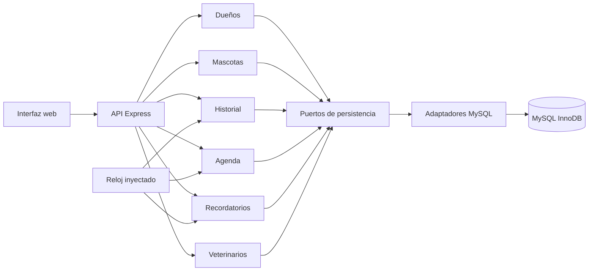
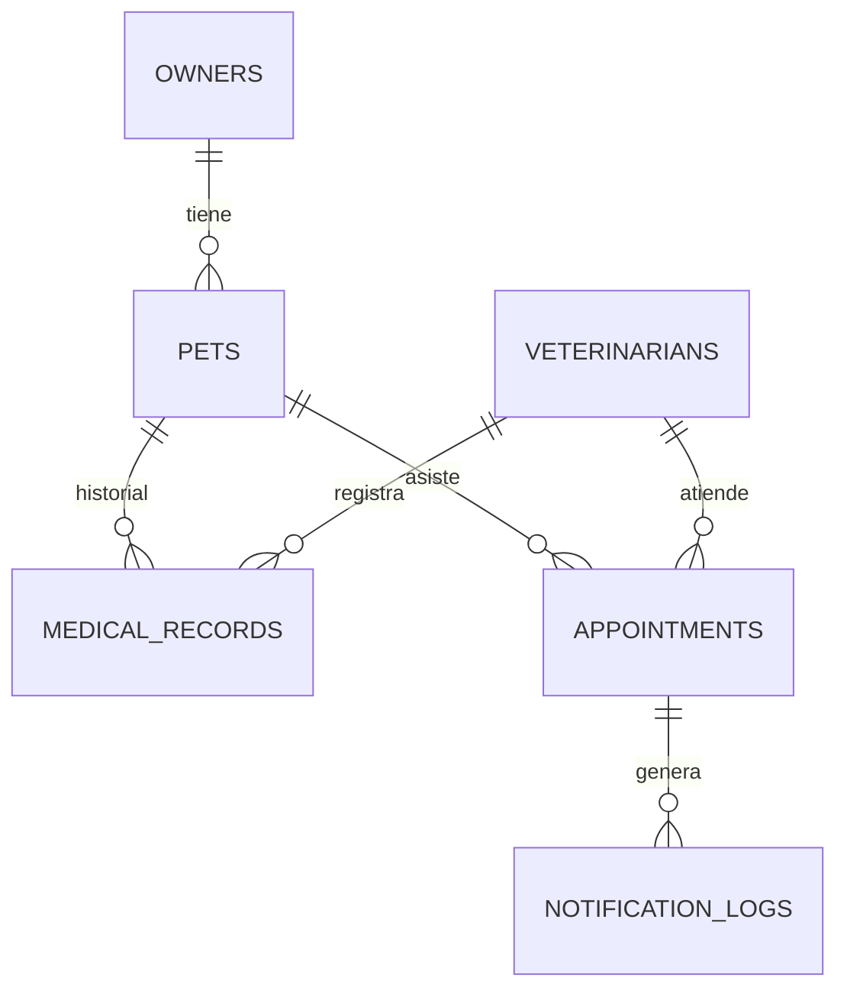

# Arquitectura de VetSync

## Contexto y módulos

Un monolito modular con un servidor HTTP y una BD MySQL 8.4. El transporte HTTP traduce solicitudes y errores y, para las operaciones con reglas, delega en casos de uso; algunas lecturas simples consultan directamente un repositorio (ver «Rutas HTTP y casos de uso»). Las reglas no dependen de Express ni de mysql2. La composición de adaptadores está en `src/composition.ts`.

No se crea una clase de servicio para listar veterinarios, citas ni avisos: son lecturas sin regla adicional y la capa HTTP las pide al repositorio inyectado. Las clases de casos de uso dependen de interfaces pequeñas. El correo es un registro simulado persistente; no hay envío SMTP.

## Modelo relacional

El esquema ejecutable y sus índices están en `database/migrations/001-initial.sql`. Las fechas de citas, historial y avisos se almacenan como DATETIME(3) interpretado en UTC por el adaptador. La fecha de nacimiento es DATE, sin hora. Las consultas usan parámetros.

## Reserva transaccional

1. Validar referencias, fechas con zona, futuro e intervalo.
2. Comenzar transacción READ COMMITTED.
3. Bloquear la fila del veterinario activo con `SELECT ... FOR UPDATE`.
4. Verificar mascota y consultar cruces con `starts_at < nuevoFin AND ends_at > nuevoInicio`.
5. Insertar o devolver conflicto; confirmar o deshacer y liberar la conexión. Si también falla el rollback, conservar ambos fallos en un AggregateError cuya causa es el error original.

La fila del veterinario existe aun cuando no tiene citas; esto protege la primera reserva simultánea. Se permiten citas contiguas y horarios iguales de veterinarios distintos. Las reglas futuras de reprogramación tendrían que seguir el mismo protocolo.

Las lecturas de referencias y las proyecciones SQL con JOIN son fronteras de integración explícitas: los adaptadores pueden consultar identificadores y proyecciones de tablas relacionadas. Los casos de uso no importan adaptadores ajenos ni acceden a sus repositorios internos. La agenda coordina el bloqueo de veterinario y la escritura de cita dentro de una sola transacción; no se distribuye esa unidad entre servicios de red.

Referencia consultada: [MySQL 8.4, locking reads](https://dev.mysql.com/doc/refman/8.4/en/innodb-locking-reads.html).

## Recordatorios e idempotencia

Ventana: `ahora < inicio <= ahora + REMINDER_HOURS`. El reloj se toma una vez por ejecución. Una consulta conjunta obtiene mascota y correo del dueño, evitando una consulta adicional por cita. La restricción única `(appointment_id, type)` garantiza un solo aviso incluso con dos ejecuciones concurrentes. Solo se ignora el error de duplicación esperado; otros errores se propagan.

El texto del aviso se formatea en `CLINIC_TIMEZONE` y señala la zona, sin cambiar el instante UTC persistido ni la ventana temporal. La zona se valida con Intl al cargar la configuración; el esquema puro está en `src/shared/environment.ts` y tiene pruebas unitarias.

El proceso se activa desde la interfaz o `POST /api/notifications/run`. No hay un planificador automático en esta primera versión. La simulación es una escritura atómica de BD; un envío de correo real necesitaría otro diseño de entrega y reintentos.

## Rutas HTTP y casos de uso

Según `src/http/app.ts`:

| Ruta | Quién atiende |
| --- | --- |
| `GET/POST /api/owners` | Caso de uso `Owners` |
| `GET/POST /api/pets` | Caso de uso `Pets` |
| `GET/POST /api/pets/:petId/medical-records` | Caso de uso `MedicalRecords` |
| `GET /api/appointments/availability` | Caso de uso `ListAvailability` |
| `POST /api/appointments` | Caso de uso `ScheduleAppointment` |
| `POST /api/notifications/run` | Caso de uso `SendReminders` (el límite HTTP solo valida que el cuerpo sea `{}` o no exista) |
| `GET /api/veterinarians` | Consulta directa a `VeterinarianRepository.list()` |
| `GET /api/appointments` | Consulta directa a `AppointmentRepository.list()` |
| `GET /api/notifications` | Consulta directa a `ReminderRepository.list()` |
| `GET /api/health` | Función `health` inyectada (`SELECT 1`) |
| `GET /api/config` | Sin servicio: devuelve `timeZone`, `reminderHours` y `clinicHours` como `bookingHours` |

Las tres lecturas directas no tienen regla de negocio; si se les añadiera una (filtros, permisos, paginación), deberían pasar a un caso de uso. La composición (`src/composition.ts`) inyecta reloj, zona y repositorios.

## Horario de la clínica y disponibilidad

`clinicHours` (`src/modules/appointments/domain/clinic-hours.ts`: apertura 10:00, cierre 18:00, bloques de 30 minutos) es la **única fuente** del horario. `bookingWindow()` y `formatClock()` derivan de ella los minutos del día que usan tanto `ListAvailability` como `assertClinicHours` (validación al agendar), y `/api/config` publica el mismo objeto como `bookingHours`. La interfaz toma de `/config` el texto del horario y no calcula bloques: los entrega la API.

`ListAvailability` recibe un `date` (AAAA-MM-DD) y un `veterinarianId`, comprueba que el veterinario activo exista y construye los bloques de 30 minutos en la zona de la clínica con `clinicInstant`. Un bloque es `past` si su inicio es menor o igual que «ahora» (reloj inyectado), `occupied` si se solapa con una cita de ese veterinario y disponible en otro caso. Carga las citas con `repository.list()` y filtra en memoria, lo que es lineal en el número de citas; es informativa y no sustituye la comprobación transaccional del POST. `clinicInstant` construye los instantes con `setUTCFullYear` (no `Date.UTC`, que interpreta los años 0-99 como 1900-1999), de modo que cualquier fecha ISO válida devuelve los bloques del año pedido.

## Zona de la clínica y zona del dispositivo

La **zona de la clínica** (`CLINIC_TIMEZONE`, por defecto America/Hermosillo) rige: las reglas de horario de citas, la disponibilidad, el texto de los recordatorios, la fecha límite de nacimiento (`Pets` recibe `timeZone` por composición y compara con `calendarDay(ahora, zona)` de `src/shared/clock.ts`, no con el día UTC), la agenda e historial que muestra la interfaz y el selector de fecha de la cita (`clinicDay()`). La **zona del dispositivo** solo se usa hoy en el campo `datetime-local` de la nota clínica (`recordedAt`), que se convierte a UTC con la zona del navegador; el formulario muestra un aviso con ambas zonas cuando difieren. El formulario de cita no usa la zona del dispositivo: fecha y turno se interpretan en la zona de la clínica. Limitación conocida: el atributo `max` del campo de nacimiento en la interfaz se calcula con el día UTC del navegador, por lo que puede diferir del día de la clínica; el servidor es quien decide.

## Interfaz, validación y errores

La interfaz usa DOM y `textContent` para datos externos; no interpola notas o nombres en HTML. `src/web/messages.ts` traduce a español los mensajes de validación (Zod) y de red que llegan a la interfaz, y las respuestas que no son JSON no muestran detalle. La interfaz recupera los fallos: un refresco fallido tras un alta confirmada conserva lo guardado, un 409 vuelve a consultar la disponibilidad y los errores de selector se asocian al campo.

Se exige JSON para escrituras, se limita el cuerpo a 32 KB, no se habilita CORS, se usa Helmet y se ocultan detalles internos al cliente. Los recursos estáticos se sirven desde `dist/web`; no se expone el código TypeScript por HTTP.

El middleware central de `src/http/app.ts` clasifica los errores por tipo, sin confiar en un `status` arbitrario:

- `AppError` del dominio: su `status` y `code` (400 validación, 404, 409 conflicto).
- Errores de `body-parser`, por su `type` explícito: `entity.parse.failed` 400 `INVALID_JSON`; `entity.too.large` 413 `PAYLOAD_TOO_LARGE`; `charset.unsupported` 415 `UNSUPPORTED_CHARSET`; `encoding.unsupported` 415 `UNSUPPORTED_CONTENT_ENCODING`; `request.aborted` 400 `REQUEST_ABORTED`; `request.size.invalid` 400 `INVALID_REQUEST_SIZE`; `entity.verify.failed` 403 `BODY_VERIFICATION_FAILED` (defensivo: no hay verificación configurada).
- `URIError` de Express 5 por parámetro de ruta mal codificado: 400 `INVALID_PARAMETER`.
- Fallos de descompresión (zlib/brotli) envueltos por `body-parser` (sin `type`, con `errno` numérico): 400 `INVALID_BODY_ENCODING`.
- Cualquier otro error: 500 `INTERNAL_ERROR`, con el detalle solo en el registro del servidor.

El middleware previo de `/api` devuelve 415 `UNSUPPORTED_MEDIA_TYPE` a un POST sin JSON.

Se exige JSON para escrituras, se limita el cuerpo a 32 KB, no se habilita CORS, se usa Helmet y se ocultan detalles internos al cliente. Los recursos estáticos se sirven desde `dist/web`; no se expone el código TypeScript por HTTP.

Express 5 conduce errores de handlers async al middleware central. Referencia: [manejo de errores de Express](https://expressjs.com/en/guide/error-handling/).

La aplicación es una demostración local sin autenticación, sin paginación y con datos ficticios. La gestión de roles, publicación pública, volúmenes grandes de datos, auditoría clínica y videollamadas quedan fuera de este alcance.

## Dependencias

Se fijan versiones exactas y lockfile. El override de `minimatch` >=7 y <11 a 11.0.5 corrige una alerta transitiva en herramientas de desarrollo. Se inspeccionaron sus consumidores y se ejecutó el linter con la versión sustituida. Esta decisión debe reevaluarse al actualizar ESLint y typescript-eslint; no se aplicó `npm audit fix --force`.

## Exclusiones de cobertura

La cobertura incluye casos de uso, adaptadores SQL, validadores y API (incluida la traducción de errores HTTP). Se excluyen el punto de arranque y configuración (dependen del proceso y entorno), el ensamblado de dependencias y la interfaz web. La UI se verifica con Playwright, con respuestas controladas para los recorridos de recuperación y con MySQL de pruebas para los recorridos completos; las capturas automáticas se guardan en `work/playwright-results/` y no en `docs/evidencias/capturas/`. Las exclusiones no incluyen reglas de agenda, notificaciones, horario de clínica ni validación del esquema de entorno. Los umbrales y resultados numéricos se registran en el informe de pruebas, no aquí.
